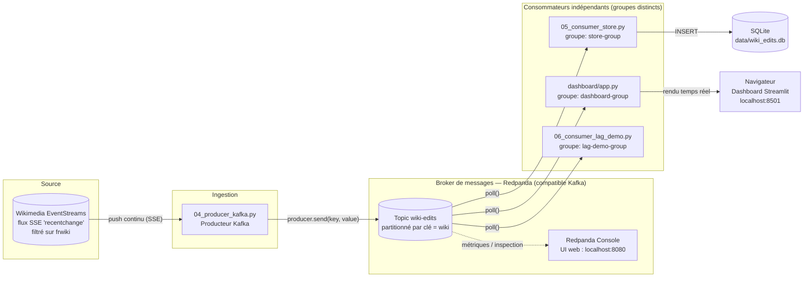

# Démo streaming de données — Wikimedia EventStreams

Dépôt de démonstration pour illustrer le concept de streaming de données, en s'appuyant sur le flux public **Wikimedia EventStreams**
(`recentchanges`), un vrai flux Server Sent Event (SSE) poussé en continu, sans clé API.

## Arborescence

```
streaming-demo/
├── docker-compose.yml        # Redpanda (broker compatible Kafka) + Console web
├── requirements.txt
├── scripts/
│   ├── 01_batch_poll.py      # Etape 1 : polling REST classique (contre-exemple)
│   ├── 02_stream_raw.py      # Etape 2 : connexion brute au flux SSE
│   ├── 03_stream_windowed.py # Etape 3 : filtrage + agrégation par fenêtre
│   ├── 04_producer_kafka.py  # Etape 4 : normalise et pousse vers Redpanda
│   ├── 05_consumer_store.py  # Etape 4 : consommateur -> SQLite (persistance)
│   └── 06_consumer_lag_demo.py # Etape 6 : démo de lag / backpressure
└── dashboard/
    └── app.py                # Etape 5 : dashboard Streamlit temps réel
```

## Prérequis

- Python 3.10+
- Docker + Docker Compose (pour les étapes 4 à 6)
- Accès internet vers `stream.wikimedia.org` (port 443)

Installation :

```bash
python -m venv venv && source venv/bin/activate
pip install -r requirements.txt
```

## Correspondance fichiers ↔ étapes (attention à la numérotation)

Les numéros de fichiers ne correspondent pas un-à-un aux étapes du scénario :

| Fichier | Étape | Rôle |
|---|---|---|
| `01_batch_poll.py` | 1 | polling REST classique |
| `02_stream_raw.py` | 2 | flux brut |
| `03_stream_windowed.py` | 3 | filtrage + fenêtrage |
| `04_producer_kafka.py` | 4 | producteur vers Redpanda |
| `05_consumer_store.py` | **4** (suite) | 1er consommateur (persistance SQLite) |
| `dashboard/app.py` | **5** | 2e consommateur (visualisation temps réel) |
| `06_consumer_lag_demo.py` | 6 | 3e consommateur (lag / backpressure) |

`05_consumer_store.py` fait partie de l'étape 4 malgré son numéro : le
producteur seul ne sert à rien sans au moins un consommateur pour
vérifier que les messages arrivent bien dans le broker.

## Déroulé de la démo (voir chaque script pour les commentaires pédagogiques)

### Étape 1 : Batch vs streaming
```bash
python scripts/01_batch_poll.py
```
Interroge l'API MediaWiki toutes les 5 secondes : montre le polling, la
latence et les événements manqués entre deux appels.

### Étape 2 : Flux brut
```bash
python scripts/02_stream_raw.py --wiki frwiki
```
Affiche chaque événement du flux SSE dès son arrivée, sans les demander.
Filtre sur le même wiki et affiche les mêmes champs que le script 01
(titre, utilisateur, bot/humain, taille avant → après, horodatage), pour
une comparaison directe entre polling et streaming sur des données
identiques. Utilisez `--wiki all` pour voir tous les projets Wikimedia.

### Étape 3 : Traitement à la volée
```bash
python scripts/03_stream_windowed.py --wiki frwiki --window 10
```
Filtre sur un wiki donné et affiche un compteur agrégé par fenêtre
temporelle (tumbling window) de N secondes, avec la part de bots.

### Étape 4 : Introduire le broker (Redpanda)
```bash
docker compose up -d
python scripts/04_producer_kafka.py --wiki frwiki   # terminal A : producteur
python scripts/05_consumer_store.py                 # terminal B : 1er consommateur
```
Le producteur filtre sur `frwiki` avant d'envoyer au topic (comme les
scripts 01 à 03) : tout ce qui circule ensuite dans le broker — et donc
tout ce que lisent `05_consumer_store.py`, le dashboard et
`06_consumer_lag_demo.py` — ne contient que des données françaises, sans
avoir à refiltrer à chaque étape. Utilisez `--wiki all` pour repasser sur
tous les projets Wikimedia.

La Console web de Redpanda est disponible sur http://localhost:8080 pour
observer topics, partitions et consumer groups en direct.

### Étape 5 : Dashboard temps réel
```bash
streamlit run dashboard/app.py             # terminal C : 2e consommateur (visualisation)
```
Le producteur (terminal A) doit continuer de tourner. Le dashboard est un
consommateur indépendant (groupe `dashboard-group`), qui lit le même topic
que `05_consumer_store.py` sans interférer avec lui — bon moment pour
montrer le découplage apporté par le broker : plusieurs consommateurs,
plusieurs usages, une seule source de données.

Voici le diagramme permettant de visualiser le pipeline :


### Étape 6 : Pour aller plus loin, panne, lag, backpressure
```bash
python scripts/06_consumer_lag_demo.py --sleep 2
```
Simule un consommateur lent, affiche le lag qui grandit, puis montre le
rattrapage. Observer dans la console RedPanda, bon support pour discuter *at-least-once* et l'idempotence.

## Nettoyage

```bash
docker compose down -v
```
